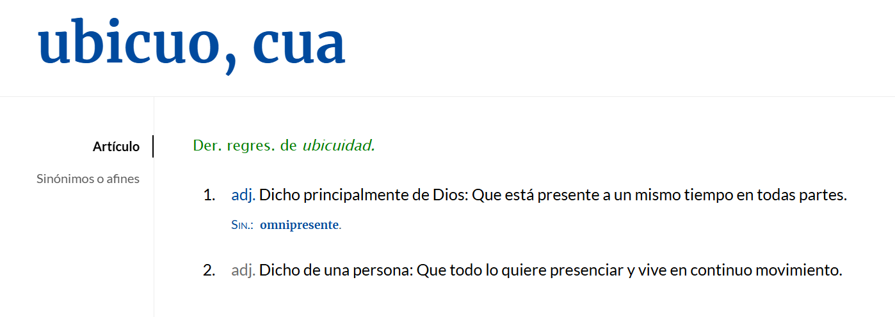
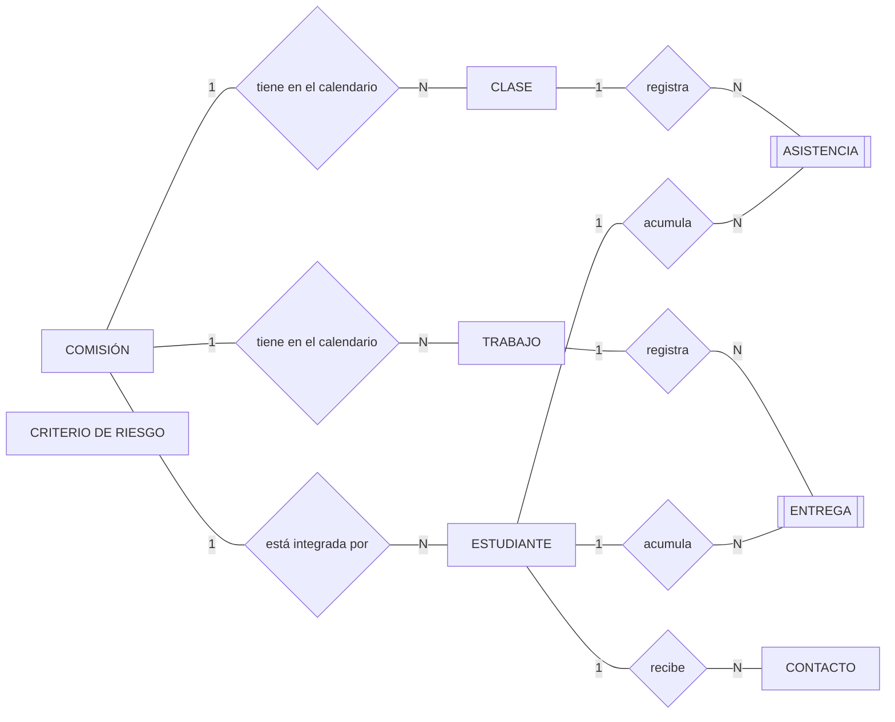
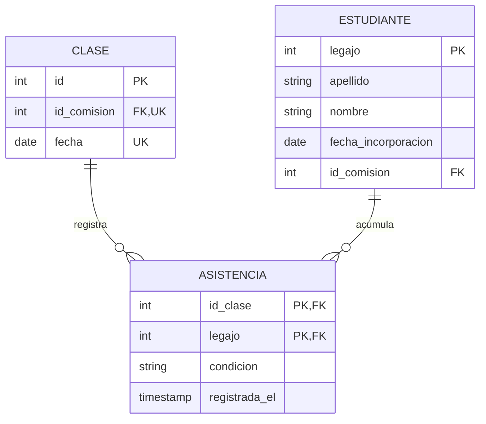

# Análisis y diseño de la solución

## Estructura de la unidad

### Finalidad: ¿Para qué?

- fijar el vocabulario del problema en un modelo que el cliente pueda leer y corregir;
- elegir una solución entre varias, en lugar de aceptar la primera;
- fundamentar esa elección con criterios explícitos y verificables;
- traducir el problema relevado a modelos que permitan construirlo;
- organizar el sistema de modo que el costo del cambio se mantenga bajo;
- y dejar registro de las decisiones tomadas, para poder defenderlas y para poder revisarlas.

### Fundamentos: ¿Por qué?

- toda decisión de diseño tiene un costo, y el costo que no se explicita se paga igual;
- las decisiones tomadas temprano se toman con la menor cantidad de información disponible;
- el costo de revertir una decisión crece con el tiempo y con el código construido encima;
- un diseño que no se puede verificar no puede considerarse terminado;
- y lo que no se encapsula se disemina, de modo que cada cambio posterior obliga a intervenir en muchos lugares.

El concepto de **costo del cambio** adquiere centralidad. Toda decisión de diseño puede evaluarse por su efecto sobre él: una estructura que concentra en un único lugar aquello que se espera que cambie reduce el costo de los cambios futuros; una que lo dispersa lo multiplica. La dificultad es que ese costo no se manifiesta en el momento en que la decisión se toma, sino varios incrementos después, cuando corregirla ya implica reescribir.

### Mecanismos: ¿Cómo?

El diseño de una solución no se realiza mediante una técnica única ni produce un artefacto único. Se realiza a través de un conjunto articulado de análisis, modelos y decisiones registradas, cuya finalidad es reducir la incertidumbre antes de comprometer construcción:

- construcción del modelo de dominio: los conceptos del problema, sus relaciones y su vocabulario;
- comparación de alternativas de solución y evaluación de su factibilidad;
- modelado del comportamiento mediante casos de uso y diagramas de secuencia;
- modelado de datos mediante entidad-relación y su derivación al modelo relacional;
- descomposición en componentes según criterios de cohesión, acoplamiento e interfaz;
- definición de la arquitectura y de la dirección de las dependencias;
- especificación de los atributos de calidad como escenarios verificables;
- prototipado y evaluación de la interfaz antes de su construcción;
- selección fundamentada del conjunto de tecnologías y herramientas;
- y registro de las decisiones adoptadas mediante ADR.

--------

# El dominio

Todo sistema de software se construye para un ámbito de actividad que existe antes que él y que seguiría existiendo sin él. Una biblioteca presta libros, una escuela registra la asistencia de sus estudiantes, una obra social autoriza prácticas médicas. Cada una de esas actividades tiene sus propios conceptos, sus reglas, sus excepciones y su vocabulario, y ninguno de ellos lo inventó el equipo de desarrollo. Ese ámbito —la parcela del mundo real sobre la que el sistema va a operar— es el **dominio**.

La distinción ordena el trabajo de toda la unidad. El dominio pertenece al espacio del problema: describe cómo funciona la actividad, con independencia del software que se decida construir. La arquitectura, las tecnologías, el esquema de la base de datos y la interfaz pertenecen al espacio de la solución, y sólo se justifican medidos contra el problema al que responden.

El conocimiento del dominio no suele estar escrito en ningún lado, sino que está repartido entre las personas que trabajan en él todos los días —los **expertos del dominio**— y en buena medida es tácito: lo aplican con soltura sin poder enunciarlo. De ahí que el análisis no consista en recibir una especificación sino en construirla junto a ellos, y que en el relevamiento las preguntas valgan tanto como las respuestas.

Comprender un dominio tampoco significa reproducirlo. Un modelo es una simplificación deliberada: retiene lo que el problema exige y descarta todo lo demás. No existe *el* modelo correcto de un dominio; existe un modelo útil para el sistema que se está construyendo, y deja de serlo cuando cambia aquello que el sistema debe resolver.

Cuando el equipo y el cliente hablan de lo mismo con palabras distintas, alguien traduce. El bibliotecario dice "socio" y el sistema guarda un `Usuario`; el cliente llama "baja" a lo que en la base de datos es un campo `activo = false`. Cada traducción es una oportunidad de error que no deja rastro: nadie la registra, nadie la revisa y su costo aparece mucho después, cuando lo construido no es lo que se había pedido y ambas partes creen tener razón.

Domain-Driven Design propone eliminar esa traducción en lugar de administrarla. El **lenguaje ubicuo** es un vocabulario único, construido entre el equipo y los expertos del dominio, que se usa sin variantes en las conversaciones, en las historias de usuario, en los diagramas, en el modelo de datos y en el código fuente.

>Usen el modelo como columna vertebral de un lenguaje. Comprometan al equipo a ejercitar ese lenguaje sin excepciones en toda comunicación dentro del equipo y en el código. Usen el mismo lenguaje en los diagramas, en los textos y sobre todo al hablar.
>
>Domain-Driven Design - Eric Evans, cap. 2, "Ubiquitous Language"

La regla práctica es directa: si en una reunión alguien necesita traducir, el lenguaje todavía no es ubicuo. El esfuerzo de sostenerlo lo paga el equipo, no el cliente, porque es el equipo el que tiene la libertad de elegir cómo nombrar sus propias construcciones.

## Definición de RAE


## Modelo de dominio

El modelado de dominio es una actividad de análisis que busca comprender y representar el mundo del problema para el cual se construirá un sistema de software. Antes de hablar de pantallas, bases de datos, clases de programación o tecnología, necesitamos entender qué conceptos existen en el negocio, cómo se relacionan, qué reglas deben cumplirse y qué vocabulario usan las personas que conocen ese dominio.

Modelar el negocio completo resulta desproporcionado en la mayoría de los proyectos, y prescribe para esos casos una forma reducida: el **modelado del dominio**, que se limita a los conceptos importantes del problema y omite los procesos de la organización.

>Un modelo de dominio captura los tipos de objetos más importantes en el contexto del sistema. Los objetos de dominio representan las cosas que existen o los eventos que ocurren en el entorno en el que el sistema trabaja.
>
>The Unified Software Development Process - Jacobson, Booch y Rumbaugh

### Las tres construcciones

El modelo se dibuja como un diagrama de clases de UML restringido a tres elementos.

| Construcción | Qué representa | Regla práctica |
|---|---|---|
| **Clase conceptual** | Una idea, cosa u objeto del dominio | Si el cliente la nombra en una conversación, es candidata |
| **Asociación** | Una relación entre conceptos que debe conservarse | Se nombra con una frase verbal legible y lleva multiplicidad en ambos extremos |
| **Atributo** | Un dato simple de un concepto | Texto, número, fecha o estado. Nada más |

**Si algo no se piensa como un número o un texto, no es un atributo.** La comisión no es una cadena dentro del estudiante: es un concepto con identidad propia, y por lo tanto se representa como clase y se vincula mediante una asociación. Cuando un atributo se transforma en clase, el modelo gana un lugar donde colgar lo que el cliente todavía no dijo.

**Sólo se incluyen las asociaciones cuyo conocimiento debe preservarse.** Un modelo que dibuja toda relación concebible se vuelve ilegible sin agregar información. El criterio es si el sistema necesita recordar esa relación a lo largo del tiempo.

### El modelo como acuerdo

El modelo de dominio no se construye para documentar: se construye para acordar. Su destinatario inmediato es el cliente, que debe poder leerlo y corregirlo, y por eso se escribe en su vocabulario y no en el del equipo. Es el mismo criterio que ordenó el glosario durante el relevamiento, y es la razón por la que ambos artefactos se validan juntos: el glosario define los términos y el modelo muestra cómo se relacionan.

Se extiende la consecuencia hasta el código. Si las clases del programa llevan los nombres del dominio, cada conversación entre el equipo y el cliente se sostiene sobre los mismos términos y desaparece la traducción intermedia. El costo de esa traducción no se percibe al principio: aparece cuando el cliente rechaza un incremento porque lo construido no es lo que había pedido, y ambas partes tienen razón.

### Un Modelo de Dominio

```text
   ┌──────────────┐    ┌──────────────┐
   │   ESTANTE    │    │     OBRA     │◄─────────────────────┐
   └──────▲───────┘    └──────┬───────┘                      │
          │                   │ se materializa en            │
          │            ┌──────┴───────┐               ┌──────┴───────┐
          └────────────┤    LIBRO     │               │   RESERVA    │
                       └──────┬───────┘               └──────┬───────┘
                              │                              │
   ┌──────────────┐           │                              │
   │  REGLAMENTO  │           │                              │
   └──────┬───────┘           │                              │
          │ rige              ▼                              ▼
          │            ┌──────────────┐   lo recibe   ┌──────────────┐
          └───────────►│   PRÉSTAMO   │──────────────►│    SOCIO     │
                       └──────┬───────┘               └──────▲───────┘
                              │                              │
                       ┌──────┴───────┐                      │
                       │   SANCIÓN    │──────────────────────┘
                       └──────────────┘   inhabilita a
```

Un modelo de dominio sirve tanto por lo que afirma como por las preguntas que vuelve visibles:
- ¿Todos los libros están disponibles para ser prestados?
- ¿De dónde salen los libros? ¿Los compras, te los donan?
- ¿Que informes tenes actualmente?
- Contame un poco en que consiste el reglamento

Algunas preguntas importantes pero no para este momento:
- ¿Cuános días se prestan los libros?
- ¿Te comunicas con el socio cuando está retrasado en la devolución?

Fuera del modelo quedaron la editorial de cada obra y el bibliotecario que atiende el mostrador. Existen en la biblioteca, pero ninguna de las historias priorizadas los necesita, y un concepto que no sostiene ninguna historia sólo agrega ruido a la conversación con el cliente. Tampoco están los valores que se calculan: el atraso de un préstamo no es un concepto del dominio, es lo que resulta de mirar el préstamo contra el reglamento.

### Un modelo por iteración

No se completa antes de construir: se arma una primera versión con los conceptos que las historias priorizadas necesitan, y se amplía en cada iteración a medida que el relevamiento avanza y el cliente corrige. Un modelo terminado en la primera semana es un modelo construido sobre supuestos, y su exhaustividad no lo hace más confiable sino más caro de corregir.

El criterio de tamaño es el uso: el modelo sirve mientras se lo puede leer completo y discutir en una reunión. Cuando deja de caber en esa conversación, dejó de cumplir su función de vocabulario compartido y se convirtió en documentación.

### Síntesis

El modelo de dominio es el glosario dibujado: los conceptos del problema, sus relaciones y sus datos simples, **en las palabras del cliente y sin decisiones de software**. Se construye durante el relevamiento, se valida con quien conoce el dominio y se amplía en cada iteración. Su valor no reside en la completitud del diagrama sino en dos efectos: fija el vocabulario con el que se van a escribir las historias, el modelo de datos y el código, y hace visible lo que el dominio todavía no tiene resuelto. Un modelo que no puede leerse en una reunión, o que el cliente nunca leyó, no cumple ninguna de las dos funciones.

## Fuentes

- Evans, E. (2003). *Domain-Driven Design*, Addison-Wesley, cap. 1, "Crunching Knowledge", y cap. 2, "Communication and the Use of Language", patrón "Ubiquitous Language". Fragmento traducido disponible en el repositorio: [DDD - Lenguaje ubicuo](/unidad-2/DDD%20-%20Lenguaje%20ubicuo.pdf).
- Jacobson, I., Booch, G. y Rumbaugh, J. (1999). *The Unified Software Development Process*, Addison-Wesley, cap. 6, "Capturing Requirements", secc. "Understanding the System Context Using a Domain Model".
- Larman, C. *Applying UML and Patterns* (3ª ed.), Prentice Hall, cap. 9, "Domain Models: Visualizing Concepts".
- Fowler, M. — "Ubiquitous Language", https://martinfowler.com/bliki/UbiquitousLanguage.html

--------

# Alternativas de solución y factibilidad

### Antes de comenzar...

- ¿tenemos que decidir la arquitectura antes de saber qué vamos a construir?
- ¿qué decisiones conviene tomar ahora, y cuáles podemos dejar para más adelante?

Este tema lo vamos a ver de forma general, para tener una noción de cómo se decide en un proyecto. No buscamos hacer un estudio de factibilidad completo ni diseñar arquitecturas en papel antes de construir. El software se construye de a poco, y buena parte de la arquitectura se va encontrando en el camino. Lo que sí necesitamos es saber distinguir las pocas decisiones que conviene pensar antes, de las muchas que podemos ir descubriendo.

### Alternativas sobre el problema, no sobre la arquitectura

Cuando hablamos de alternativas no nos referimos a dibujar tres arquitecturas y elegir una. Eso supondría saber de antemano qué vamos a construir, y justamente es lo que todavía no sabemos. Las alternativas que sí tiene sentido pensar al inicio son sobre el problema:
- ¿hace falta construir software, o el problema se resuelve con herramientas que ya existen?;
- ¿qué parte del problema vamos a resolver en esta versión?;
- ¿qué pasaría si no construyéramos nada, y la clienta siguiera como hoy?

La arquitectura y la tecnología también son decisiones, pero no se eligen de entrada entre opciones prefabricadas. Se van definiendo a medida que construimos y aprendemos. Si arrancamos discutiendo qué framework usar, ya dimos por resuelto, sin discutirlo, que vamos a construir software a medida y que el alcance es el total.

### Decidir en el último momento responsable

No se trata de postergar, sino de no decidir antes de tener la información necesaria. Cada decisión que tomamos temprano la tomamos sabiendo lo mínimo sobre el problema. Si podemos esperar a conocer mejor lo que tenemos que construir, la decisión va a ser mejor.

Pero no todas las decisiones pueden esperar lo mismo, porque no todas cuestan lo mismo de revertir.

> La arquitectura representa las decisiones de diseño significativas que dan forma a un sistema, donde la significancia se mide por el costo del cambio.
>
> Grady Booch

### La factibilidad como riesgos a despejar

La pregunta de factibilidad es si la solución puede realmente llevarse a cabo. En lugar de responderla con un estudio en papel al inicio del proyecto, la vamos a pensar como una lista de riesgos que se despejan construyendo y probando. Son cuatro dimensiones, y alcanza con que una falle para que la solución no sea viable.

| Dimensión | Pregunta | Cómo la despejamos |
|---|---|---|
| **Técnica** | ¿Existe la tecnología y el equipo sabe usarla? | Construyendo una prueba mínima de punta a punta |
| **Operativa** | ¿Alguien va a usar el sistema en su trabajo real? | Mostrándole a la usuaria algo usable lo antes posible |
| **Económica** | ¿El beneficio justifica el esfuerzo? | Comparando contra la alternativa de no construir |
| **Temporal** | ¿Entra en el plazo? | Recortando alcance, porque la fecha no se mueve |

En el proyecto de la materia, la económica y la temporal ya vienen dadas: tenemos unas 60 horas-persona por equipo y una fecha fija. Lo único que podemos ajustar es el alcance.

Las dos que requieren trabajo real son la técnica y la operativa. La técnica no se responde discutiendo si "podemos hacerlo", sino construyéndolo en pequeño. La operativa es la que más proyectos correctos hace fracasar: un sistema que depende de que alguien cargue datos en un momento en que está ocupado con otra cosa, no va a ser alimentado, por más bien construido que esté. Ninguna de las dos se despeja del todo al inicio: se vuelven a mirar en cada incremento.

### Aplicación al proyecto guía

| | **A. Planilla instrumentada** | **B. Aplicación con panel** | **C. Integración con el sistema académico** |
|---|---|---|---|
| Qué es | Planilla con fórmulas de riesgo y formato condicional | Aplicación propia: registro, cálculo, panel e intervenciones | La anterior, alimentada desde el sistema del instituto |
| Qué resuelve | El cruce entre asistencia y entregas | El cruce, la priorización y el seguimiento en el tiempo | Todo lo anterior, sin carga manual |
| Riesgo principal | La clienta tiene que mantener fórmulas | Que registrar la asistencia le lleve más tiempo del que tiene | **Inviable**: el instituto no expone su base de datos |

Estas no son tres arquitecturas, son tres formas de resolver el problema de la clienta.

La planilla no es una opción de relleno, es nuestra vara de comparación. Si lo que proponemos construir no la supera con claridad, el problema no está en cómo lo construimos sino en cómo definimos el alcance.

La integración se descarta porque depende de algo que no controlamos. Dejarlo por escrito sirve para dos cosas: queda claro que la evaluamos, y queda identificado el camino para una versión posterior.

Elegimos B porque el problema de la clienta no es cruzar dos planillas, sino hacer un seguimiento de cada estudiante a lo largo del tiempo. Y eso es justamente lo que una planilla no hace. Lo que no decidimos todavía es cómo se organiza esa aplicación por dentro: eso lo vamos a ir encontrando a medida que construyamos las primeras historias.

### El registro de la decisión

Si las decisiones se van tomando a lo largo del proyecto, necesitamos dejarlas registradas a medida que ocurren. Una decisión que no se registra se vuelve a discutir, y generalmente en el peor momento: varios incrementos después, cuando ya hay código construido encima y nadie recuerda por qué se tomó.

Para eso vamos a usar el **registro de decisión de arquitectura** (ADR), propuesto por Michael Nygard. Es un documento breve, que se versiona junto con el código y se escribe en el momento en que se toma la decisión, no antes.

>Cada registro describe un conjunto de fuerzas y una única decisión en respuesta a ellas. [...] El documento completo debería tener una o dos páginas de extensión. Escribiremos cada uno como si fuera una conversación con un futuro desarrollador.
>
>[Documenting Architecture Decisions - Michael Nygard](https://cognitect.com/blog/2011/11/15/documenting-architecture-decisions.html)

```text
┌──────────────────────────────────────────────────────────────────────┐
│ TÍTULO         "ADR 3: El cálculo de riesgo se resuelve en el        │
│                 servidor"                                            │
│ ESTADO         propuesta | aceptada | obsoleta | reemplazada por N   │
│ CONTEXTO       Las fuerzas en juego, sin defender ninguna opción     │
│ DECISIÓN       "Vamos a...", en voz activa                           │
│ CONSECUENCIAS  Lo positivo, lo negativo y lo neutro                  │
└──────────────────────────────────────────────────────────────────────┘
```

La sección que más se omite es la de consecuencias, y es la que le da valor al registro. Si no escribimos lo negativo de una decisión, no la evaluamos: la defendimos.

Cuando una decisión cambia, el ADR no se edita. Se escribe uno nuevo que reemplaza al anterior. Así, la secuencia de ADR cuenta cómo fue apareciendo la arquitectura: qué sabíamos en cada momento y por qué decidimos lo que decidimos.

### Síntesis

Al inicio del proyecto elegimos qué problema resolver y cuánto de él, no la arquitectura. Las decisiones se toman cuando tenemos información para tomarlas, y sólo las de una vía merecen detenerse antes de construir. La factibilidad no es un estudio previo, sino un conjunto de riesgos que vamos despejando en cada incremento. Y cada decisión queda registrada en el momento en que se toma, con sus costos.

### Fuentes

- Fowler, M. (2003). "Who Needs an Architect?", *IEEE Software*, vol. 20, n.º 5. https://martinfowler.com/ieeeSoftware/whoNeedsArchitect.pdf
- Beck, K. y Andres, C. (2004). *Extreme Programming Explained* (2ª ed.), Addison-Wesley, cap. 7, "Primary Practices", práctica "Incremental Design".
- Nygard, M. (2011). "Documenting Architecture Decisions". https://cognitect.com/blog/2011/11/15/documenting-architecture-decisions.html

--------

# Modelado funcional: casos de uso y diagramas de secuencia

### El modo de uso determina el detalle

Antes de seleccionar una notación corresponde, hay que decidir para qué se la va a utilizar, porque de ese uso depende cuánto detalle resulta razonable.

| Modo | Finalidad | Detalle requerido |
|---|---|---|
| **Boceto** | Pensar de manera comunicable. Se dibuja, se discute y se descarta | El mínimo que sostenga la conversación |
| **Plano** | Especificar antes de construir. Una persona modela y otra implementa | Alto, y exige mantenimiento |
| **Lenguaje de programación** | Generar el sistema desde el modelo | Completo |

>Los diagramas de UML que dibujo suelen ser bocetos. Uso bocetos para ayudarme a comunicar ideas y alternativas sobre lo que estoy por hacer.
>
>[Martin Fowler](https://martinfowler.com/bliki/UmlAsSketch.html)

Un diagrama que debe mantenerse sincronizado manualmente con el código se desactualiza en pocos incrementos, y a partir de ese momento desinforma, lo cual es peor que su inexistencia. El criterio operativo que se deriva es directo: **se modela aquello que todavía no está decidido**. Un diagrama que representa algo que el equipo ya sabe cómo va a construir no agrega información, agrega trabajo.

### El caso de uso como descripción de comportamiento

El caso de uso describe cómo un actor alcanza un objetivo mediante el sistema, incluidos los recorridos en los que no lo alcanza. Su valor no reside en el diagrama sino en el texto, y dentro del texto, en la sección de extensiones: es la que obliga a formular qué ocurre cuando el recorrido principal se interrumpe.

El diagrama de casos de uso, por su parte, no describe comportamiento: enumera objetivos y delimita el sistema. Funciona como índice, y en esa función resulta útil. Dos criterios evitan discusiones recurrentes: la caja del diagrama es la representación literal del límite del sistema establecido en la unidad anterior, de modo que todo elemento ubicado dentro de ella debe ser construido por el equipo; y las relaciones de inclusión y extensión se emplean poco, porque descomponer casos de uso para reutilizar tres pasos produce diagramas que aparentan diseño sin serlo.


> Definición: Todas las formas de utilizar un sistema para alcanzar un objetivo concreto para un usuario específico.
>
> Un caso de uso es:
>
> - Una secuencia de acciones que realiza un sistema y que produce un resultado observable de valor para un usuario específico.
> - Ese comportamiento específico de un sistema que participa en una colaboración con un usuario para ofrecerle algo de valor.
> - La unidad mínima de actividad que proporciona un resultado significativo para el usuario.
> - El contexto para un conjunto de requisitos relacionados.
>
> [Ivar Jacobson](https://www.ivarjacobson.com/publications/white-papers-articles/use-case-definition)

Hay dos pruebas simples para decidir si algo es un caso de uso:

- La prueba del objetivo: si el tutor hace sólo eso y se va, ¿logró algo que le importa? Registrar asistencia y Corregir asistencia pasan la prueba; Marcar a todos presentes no.
- La prueba del tamaño: un caso de uso tiene varios pasos. Si describirlo lleva un solo paso, probablemente es un paso de otro caso de uso.

#### **Caso de uso: Registrar asistencia**

###### Diagrama de caso de uso

```text
                    ┌──────────────────────────────────────────────┐
                    │       Sistema de seguimiento académico       │
                    │                                              │
       ○            │          ╭───────────────────────╮           │
      ─┼─ ──────────┼─────────►│  Registrar asistencia │           │
      / \           │          ╰───────────────────────╯           │
     Tutor          │                                              │
                    └──────────────────────────────────────────────┘
```

###### Descripción del caso de uso

| | |
|---|---|
| **Actor principal** | Tutor |
| **Objetivo** | Dejar registrado quién estuvo y quién no en una clase |
| **Precondición** | El tutor está identificado y la comisión está a su cargo |
| **Garantía de éxito** | Queda registrada una asistencia por cada estudiante de la nómina en esa clase |
| **Garantía mínima** | Si el tutor no confirma, no queda registrada ninguna asistencia de esa clase |

*Escenario principal*

1. El tutor elige la comisión y la fecha de la clase.
2. El sistema muestra la nómina de la comisión, con todos los estudiantes como presentes.
3. El tutor marca a los estudiantes ausentes.
4. El tutor confirma la asistencia.
5. El sistema registra la asistencia de cada estudiante e informa cuántos presentes y ausentes quedaron.

*Extensiones*

- **1a.** La fecha no corresponde a una clase del calendario de la comisión: el sistema lo informa y el tutor elige otra fecha.
- **1b.** La asistencia de esa clase ya fue registrada: el sistema lo informa y ofrece corregirla, lo que nos lleva al caso de uso *Corregir asistencia*.
- **2a.** Un estudiante se incorporó a la comisión después de esa fecha: el sistema no lo incluye en la nómina.
- **3a.** El tutor marcó a un estudiante como ausente por error: lo vuelve a marcar como presente antes de confirmar.
- **4a.** El tutor sale sin confirmar: el sistema no registra nada, y la próxima vez que abra la clase la encuentra sin asistencia.

*Preguntas abiertas*

- ¿La llegada tarde cuenta como presente, como ausente o es una tercera condición?
- ¿Una inasistencia justificada se registra acá o en otro momento? ¿Cuenta para el riesgo?
- ¿Qué pasa con una clase que no se dictó? ¿Se marca de alguna forma para que no cuente en el porcentaje?

El escenario principal es casi obvio, y cualquiera lo hubiera escrito igual. Lo que no es obvio son las extensiones:
- qué pasa si se confirma dos veces (1b),
- qué pasa con quien se incorporó tarde (2a) o
- qué pasa si el tutor cierra la pantalla a mitad de camino (4a).

Son preguntas que la historia de usuario no formula, y que si no respondemos acá las va a responder quien programe. Las preguntas abiertas son las que todavía no sabemos responder: **no las inventamos, las llevamos a la próxima conversación con la clienta**.

Si queremos ver el recorrido completo de un vistazo, con todas sus bifurcaciones, lo podemos graficar en un **diagrama de actividad**. Cada acción es un paso de la descripción, cada rombo es una decisión que abre una extensión, y los carriles muestran quién hace cada cosa: el tutor o el sistema.

###### Diagrama de actividad

```text
                TUTOR                   ┆                  SISTEMA
                                        ┆
                  ●                     ┆
                  │                     ┆
      ┌───────────▼───────────┐         ┆
      │ Elegir la comisión y  │◄──┐     ┆
      │ la fecha de la clase  │   │     ┆
      └───────────┬───────────┘   │     ┆
                  └───────────────┼─────┼─────────────────────┐
                                  │     ┆                     ▼
                                  └─────┼── [no] informa ─────◇ ¿Es una clase del calendario?
                                        ┆                     │ [sí]
                                        ┆                     ▼
                                        ┆ ¿Ya fue registrada? ◇─[sí]─► Ofrecer corregirla ─► ◉
                                        ┆                     │ [no]
                                        ┆        ┌────────────▼────────────┐
                                        ┆        │ Mostrar la nómina, con  │
                                        ┆        │ todos como presentes    │
                                        ┆        └────────────┬────────────┘
      ┌───────────────────────┐         ┆                     │
   ┌─►│ Marcar un ausente     │◄────────┼─────────────────────┘
   │  └───────────┬───────────┘         ┆
   │              ▼                     ┆
   └────[sí]──────◇ ¿Otro ausente, o    ┆
                  │ una corrección?     ┆
                  │ [no]                ┆
                  ▼                     ┆
   ◉◄──[no]───────◇ ¿Confirma?          ┆
(no se registra   │ [sí]                ┆
 nada)            └─────────────────────┼─────────────────────┐
                                        ┆                     ▼
                                        ┆        ┌─────────────────────────┐
                                        ┆        │ Registrar la asistencia │
                                        ┆        │ e informar los totales  │
                                        ┆        └────────────┬────────────┘
                                        ┆                     ▼
                                        ┆                     ◉
```

Fijémonos en que el diagrama no agrega nada que no esté en la descripción: lo que hace es mostrarlo de otra forma. Se ve de inmediato que hay tres maneras de terminar (con la asistencia registrada, derivando a la corrección o saliendo sin guardar) y que hay dos vueltas atrás: elegir otra fecha cuando la clase no existe y seguir marcando mientras haya ausentes o correcciones. Para un caso de uso con pocas alternativas, como este, la descripción alcanza. El diagrama de actividad empieza a valer la pena cuando las bifurcaciones son tantas que el texto se vuelve difícil de seguir.

### Diagrama de secuencia del sistema

El diagrama de secuencia del sistema toma un escenario de un caso de uso y representa exclusivamente lo que atraviesa el límite: los eventos que el actor genera, su orden y las respuestas del sistema. El sistema se representa como una única línea de vida, tratado como caja negra. No aparecen clases, objetos ni almacenamiento.

Su función es precisa y temprana: **fijar la interfaz entre el sistema y su entorno**. De allí se obtienen las operaciones que el sistema debe ofrecer, que son las que posteriormente se distribuyen entre componentes.

Este es el diagrama del escenario principal de *Registrar asistencia*:

```text
    Tutor                                    :Sistema
      │                                          │
      │─── abrirClase(comisión, fecha) ─────────►│   paso 1
      │◄── nómina, todos como presentes ─────────│   paso 2
      │                                          │
   ┌──┼── loop [por cada ausente] ───────────────┼──┐
   │  │─── marcarAusente(legajo) ───────────────►│  │   paso 3
   └──┼──────────────────────────────────────────┼──┘
      │                                          │
      │─── confirmarAsistencia() ───────────────►│   paso 4
      │◄── 26 presentes, 4 ausentes ─────────────│   paso 5
      │                                          │
```

Si lo comparamos con la descripción, cada paso del escenario principal se convirtió en un mensaje o en una respuesta. Lo que el diagrama no muestra son las extensiones: un diagrama de secuencia del sistema dibuja **un** escenario, y cada extensión que quisiéramos ver sería otro diagrama. Por eso no reemplaza a la descripción, sino que la complementa.

Lo que sí nos da el diagrama es la lista de operaciones que el sistema tiene que ofrecer: `abrirClase`, `marcarAusente` y `confirmarAsistencia`. Esa lista es la interfaz del sistema con el tutor, y es lo que después vamos a repartir entre componentes.

Tanto la descripción como el diagrama ya imponen una decisión que la historia de usuario no contenía: que se marcan los ausentes y no los presentes, porque son menos. No es un detalle de pantalla, es una decisión con efecto directo sobre la factibilidad operativa: cuanto menos le cueste al tutor registrar, más probable es que lo haga. Por eso modelar temprano produce información, y no sólo documentación.

### Diagrama de clases

Entre los diagramas y el código nos falta un paso: decidir qué clases vamos a tener y qué sabe hacer cada una. Eso es lo que muestra el **diagrama de clases**.

Las clases del dominio no las inventamos ahora: son los mismos conceptos del modelo de dominio, con los mismos nombres. Lo que cambia es que ahora les asignamos responsabilidades. En el modelo de dominio, *Comisión* era un concepto relacionado con *Clase* y con *Estudiante*; en el diagrama de clases, `Comision` sabe responder cuál es la clase de una fecha y quiénes forman la nómina en ese momento. Y aparece una clase que no está en el dominio: `RegistrarAsistencia`, que es el caso de uso.

```text
┌──────────────────────────────────────────────┐
│             RegistrarAsistencia              │───────────────────────────────────────────────┐
├──────────────────────────────────────────────┤                                               │
│ + AbrirClase(comision, fecha): Nomina        │────────────────────────────────────────┐      │
│ + MarcarAusente(legajo)                      │                                        │      │
│ + MarcarPresente(legajo)                     │  «crea»  ┌──────────────────────┐      │      │
│ + ConfirmarAsistencia(): ResumenDeAsistencia │╌╌╌╌╌╌╌╌╌►│ ResumenDeAsistencia  │      │      │
└──────────────────────────────────────────────┘          ├──────────────────────┤      │      │
                │                   │                     │ + Presentes: int     │      │      │
                │                   │                     │ + Ausentes: int      │      │      │
                │                   │                     └──────────────────────┘      │      │
                │ tutor             │                                                   │      │
                │                   │                                                   │      │
                │                   │                                                   │      │
                ▼ 1                 │                                                   │      │
┌────────────────────────────────┐  │       ┌────────────────────────────┐              │      │
│             Tutor              │  │       │          Comision          │              │      │
├────────────────────────────────┤  │a cargo├────────────────────────────┤              │      │
│ + TieneACargo(comision): bool  │──┼──────►│ + ClaseDel(fecha): Clase   │              │      │
└────────────────────────────────┘  │  1..* │ + NominaAl(fecha): Nomina  │              │      │
                                    │       └────────────────────────────┘              │      │
                              clase │           ◆                     │        ausentes │      │
                       calendario   │           │                     │ estudiantes     │      │
                      ┌─────────────┼───────────┘                     │                 │      │
                      ▼ 0..*        ▼ 0..1                            ▼ 0..*            ▼ 0..* │
┌──────────────────────────────────────────┐      ┌────────────────────────────────────────┐   │
│                  Clase                   │      │               Estudiante               │   │
├──────────────────────────────────────────┤      ├────────────────────────────────────────┤   │
│ + Fecha: DateOnly                        │    1 │ + Legajo: string                       │   │
├──────────────────────────────────────────┤   ┌─►│ + FechaDeIncorporacion: DateOnly       │   │
│ + TieneAsistenciaRegistrada(): bool      │   │  ├────────────────────────────────────────┤   │
│ + RegistrarAsistencia(nomina, ausentes)  │   │  │ + EstabaIncorporadoEl(fecha): bool     │   │
└──────────────────────────────────────────┘   │  └────────────────────────────────────────┘   │
                    ◆                          │                      ▲                        │
                    ▼ 0..*                     │                      │ estudiantes            │
    ┌──────────────────────────────┐           │                      │ 0..*                   │
    │          Asistencia          │───────────┘                      │                        │
    └──────────────────────────────┘                                  │                        │
                    │                             ┌────────────────────────────────────────┐   │ nomina
                    ▼ 1                           │                 Nomina                 │   │
    ┌──────────────────────────────┐              ├────────────────────────────────────────┤   │
    │        «enumeration»         │              │ + Cantidad: int                        │◄──┘
    │          Condicion           │              ├────────────────────────────────────────┤ 0..1
    ├──────────────────────────────┤              │ + BuscarPorLegajo(legajo): Estudiante  │
    │ Presente                     │              └────────────────────────────────────────┘
    │ Ausente                      │
    └──────────────────────────────┘
```

Para leerlo:
- cada caja tiene tres compartimentos: el nombre, los atributos y los métodos. Cuando alguno no aporta nada, se omite;
- `+` es público y `-` es privado;
- la flecha indica quién conoce a quién: `Asistencia` conoce a su `Estudiante`, pero `Estudiante` no conoce sus asistencias;
- el rombo relleno (◆) es una **composición**: las asistencias pertenecen a una clase y no existen sin ella, y las clases del calendario pertenecen a una comisión;
- los números en los extremos son las multiplicidades: una clase registra de 0 a muchas asistencias (`0..*`), y cada asistencia es de exactamente un estudiante (`1`);
- la flecha punteada con «crea» es una dependencia: `RegistrarAsistencia` crea el resumen, pero no lo guarda.

Las flechas que salen de `RegistrarAsistencia` son lo que el caso de uso necesita recordar mientras dura: el `tutor` que lo ejecuta, la `clase` que abrió, la `nomina` que mostró y los `ausentes` que se fueron marcando. En el código, cada una de esas flechas es un atributo privado con el mismo nombre (`_tutor`, `_clase`, `_nomina`, `_ausentes`). La multiplicidad `0..1` de `clase` y `nomina` dice algo del recorrido: antes de `AbrirClase` todavía no hay ninguna.

Fijémonos en que la clase del caso de uso tiene los métodos del diagrama de secuencia, y las clases del dominio tienen los métodos que esas operaciones necesitan. `AbrirClase` no busca la clase recorriendo el calendario: se lo pregunta a `Comision`. `ConfirmarAsistencia` no crea las asistencias una por una: se lo pide a `Clase`. El caso de uso coordina, y cada concepto del dominio hace lo que le corresponde.

### Del caso de uso al código

>Usen el modelo como columna vertebral de un lenguaje. Comprometan al equipo a ejercitar ese lenguaje sin excepciones en toda comunicación dentro del equipo y en el código.
>
>Domain-Driven Design - Eric Evans, cap. 2, "Ubiquitous Language"

Con el diagrama de clases a la vista, veamos cómo queda *Registrar asistencia* en C#. No nos interesa acá cómo se guardan los datos ni de dónde se obtienen: nos interesa que el código hable el mismo idioma que el caso de uso. Si la clienta leyera los nombres de las clases y de los métodos, debería reconocer su trabajo.

El caso de uso se convierte en una clase con su mismo nombre, que coordina los pasos. Cada operación del diagrama de secuencia es un método, y cada extensión que interrumpe el recorrido es una excepción con nombre propio.

```csharp
public class RegistrarAsistencia
{
    private readonly Tutor _tutor;
    private Clase _clase;
    private Nomina _nomina;
    private readonly List<Estudiante> _ausentes = new List<Estudiante>();

    public RegistrarAsistencia(Tutor tutor)
    {
        _tutor = tutor;
    }

    // Pasos 1 y 2
    public Nomina AbrirClase(Comision comision, DateOnly fecha)
    {
        if (!_tutor.TieneACargo(comision))
            throw new ComisionAjenaAlTutor(comision);           // Precondición

        _clase = comision.ClaseDel(fecha);

        if (_clase == null)
            throw new ClaseFueraDelCalendario(comision, fecha);  // 1a

        if (_clase.TieneAsistenciaRegistrada())
            throw new AsistenciaYaRegistrada(_clase);            // 1b

        _nomina = comision.NominaAl(fecha);                      // 2a
        return _nomina;
    }

    // Paso 3
    public void MarcarAusente(string legajo)
    {
        Estudiante estudiante = _nomina.BuscarPorLegajo(legajo);

        if (!_ausentes.Contains(estudiante))
            _ausentes.Add(estudiante);
    }

    // 3a
    public void MarcarPresente(string legajo)
    {
        _ausentes.Remove(_nomina.BuscarPorLegajo(legajo));
    }

    // Pasos 4 y 5
    public ResumenDeAsistencia ConfirmarAsistencia()
    {
        _clase.RegistrarAsistencia(_nomina, _ausentes);

        return new ResumenDeAsistencia(
            presentes: _nomina.Cantidad - _ausentes.Count,
            ausentes: _ausentes.Count);
    }
}
```

La clase del caso de uso coordina, pero no decide las reglas del dominio. Qué clases tiene el calendario, quién forma parte de la nómina en una fecha o cómo se registra la asistencia son responsabilidades de los conceptos del modelo de dominio:

```csharp
public class Comision
{
    private readonly List<Clase> _calendario;
    private readonly List<Estudiante> _estudiantes;

    public Clase ClaseDel(DateOnly fecha)
    {
        return _calendario.FirstOrDefault(clase => clase.Fecha == fecha);
    }

    public Nomina NominaAl(DateOnly fecha)
    {
        return new Nomina(_estudiantes.Where(estudiante => estudiante.EstabaIncorporadoEl(fecha)));
    }
}

public class Clase
{
    private readonly List<Asistencia> _asistencias = new List<Asistencia>();

    public DateOnly Fecha { get; }

    public bool TieneAsistenciaRegistrada()
    {
        return _asistencias.Any();
    }

    public void RegistrarAsistencia(Nomina nomina, List<Estudiante> ausentes)
    {
        foreach (Estudiante estudiante in nomina.Estudiantes)
        {
            Condicion condicion = ausentes.Contains(estudiante) ? Condicion.Ausente : Condicion.Presente;
            _asistencias.Add(new Asistencia(estudiante, condicion));
        }
    }
}

public class Estudiante
{
    public string Legajo { get; }
    public DateOnly FechaDeIncorporacion { get; }

    public bool EstabaIncorporadoEl(DateOnly fecha)
    {
        return FechaDeIncorporacion <= fecha;
    }
}

public class Asistencia
{
    public Estudiante Estudiante { get; }
    public Condicion Condicion { get; }

    public Asistencia(Estudiante estudiante, Condicion condicion)
    {
        Estudiante = estudiante;
        Condicion = condicion;
    }
}

public enum Condicion
{
    Presente,
    Ausente
}
```

Si ponemos lado a lado el caso de uso y el código, cada elemento tiene su correspondencia:

| En el caso de uso | En el código |
|---|---|
| Caso de uso *Registrar asistencia* | Clase `RegistrarAsistencia` |
| Actor principal: Tutor | `Tutor`, que recibe el caso de uso al crearse |
| Precondición: la comisión está a su cargo | `_tutor.TieneACargo(comision)` y `ComisionAjenaAlTutor` |
| Paso 1: elige la comisión y la fecha | `AbrirClase(comision, fecha)` |
| 1a: la fecha no es una clase del calendario | `comision.ClaseDel(fecha)` y `ClaseFueraDelCalendario` |
| 1b: la asistencia ya fue registrada | `clase.TieneAsistenciaRegistrada()` y `AsistenciaYaRegistrada` |
| Paso 2 y 2a: la nómina, sin los incorporados después | `comision.NominaAl(fecha)` y `estudiante.EstabaIncorporadoEl(fecha)` |
| Paso 3: marca a los ausentes | `MarcarAusente(legajo)` |
| 3a: lo vuelve a marcar como presente | `MarcarPresente(legajo)` |
| Pasos 4 y 5: confirma, y el sistema registra e informa | `ConfirmarAsistencia()`, `clase.RegistrarAsistencia(...)` y `ResumenDeAsistencia` |
| 4a: sale sin confirmar | No hay código: si nadie llama a `ConfirmarAsistencia()`, no se registró nada |
| Condición: presente o ausente | `enum Condicion { Presente, Ausente }` |

Hay varias cosas para notar.

La garantía mínima no se programa, se diseña. Como las asistencias recién se registran en `ConfirmarAsistencia()`, un tutor que sale a mitad de camino no deja nada a medias. La extensión 4a queda resuelta por la forma en que repartimos los pasos, sin una sola línea de código dedicada a ella.

No aparecen `AsistenciaService`, `AsistenciaManager` ni `AsistenciaHelper`. Esos nombres no existen en el vocabulario de la clienta: nadie en el instituto dice "hay que llamar al manager de asistencias". Cuando un nombre del código no se puede pronunciar en una reunión con quien conoce el dominio, es una señal de que estamos modelando la aplicación y no el problema.

El nombre `Clase` es incómodo en un lenguaje de programación, donde "clase" ya significa otra cosa. La tentación es cambiarlo por `Sesion` o `Encuentro`, pero la clienta dice "clase", y en cuanto el código diga otra cosa vamos a necesitar traducir en cada conversación. El lenguaje ubicuo lo sostiene el equipo, no el cliente.

Y las preguntas abiertas también se ven en el código. `Condicion` tiene dos valores porque todavía no sabemos si la llegada tarde es una tercera condición. Cuando la clienta responda, el cambio va a tener un lugar claro donde hacerse, y va a tener el mismo nombre en la conversación y en el código.

### Síntesis

El modelado funcional no documenta: decide. Su rendimiento se concentra en los puntos donde existe incertidumbre —la operación que se repite, el comportamiento que todavía no está definido, la precondición que nadie formuló— y decae hasta volverse negativo cuando se aplica a lo que ya está resuelto. El contrato de operación es la forma en que el modelado se conecta con la verificación, y por lo tanto con la noción de terminado.

### Fuentes

- Larman, C. *Applying UML and Patterns* (3ª ed.), Prentice Hall, cap. 6, "Use Cases", §6.5 "Use Cases in Two Formats"; cap. 10, "System Sequence Diagrams"; cap. 11, "Operation Contracts".
- Fowler, M. (2003). *UML Distilled* (3ª ed.), Addison-Wesley, cap. 4, "Sequence Diagrams". Ed. en castellano: *UML gota a gota*.
- Cockburn, A. (2000). *Writing Effective Use Cases*, Addison-Wesley, cap. 2, "A Use Case Is a Prose Essay", y cap. 6, "Preconditions, Triggers, and Guarantees".
- Meyer, B. (1997). *Object-Oriented Software Construction* (2ª ed.), Prentice Hall, cap. 11, "Design by Contract: Building Reliable Software".
- Fowler, M. — "UmlMode", https://martinfowler.com/bliki/UmlMode.html · "UmlAsSketch", https://martinfowler.com/bliki/UmlAsSketch.html

--------

# Modelado de datos

El modelo de dominio nos dijo qué existe en el problema y cómo se relaciona, en el vocabulario del cliente. Ahora tenemos que decidir qué de todo eso vamos a **recordar**, y cómo. Para llegar a la base de datos vamos a recorrer tres pasos, y cada uno responde una pregunta distinta:

| Modelo | Pregunta que responde | Con quién lo validamos |
|---|---|---|
| **Modelo de dominio** | ¿Qué conceptos existen en el problema y cómo se relacionan? | Con el cliente |
| **MER** (modelo entidad-relación) | ¿Qué necesitamos recordar, cómo distinguimos cada cosa de las demás y cuántas se relacionan con cuántas? | Con el equipo, y con el cliente para las cardinalidades |
| **DER** (diagrama del modelo relacional) | ¿En qué tablas, columnas y claves lo guardamos? | Con el equipo y con el motor |

En la bibliografía las siglas MER y DER no siempre se usan igual. En esta materia llamamos **MER** al modelo conceptual, con entidades, atributos y relaciones, y **DER** al diagrama de tablas que derivamos de él, que es el que termina escrito en SQL.

Lo importante es que ningún paso inventa conceptos. Cada uno toma lo que dejó el anterior y le agrega **una sola clase de decisión**: el MER agrega la identidad y la cardinalidad, el DER agrega la forma de guardarlo. Si en el DER aparece una tabla que no podemos rastrear hasta un concepto del dominio, o hasta una necesidad concreta de la solución, algo se nos coló en el camino.

### Del modelo de dominio al MER

Peter Chen propuso el modelo entidad-relación con un objetivo claro: que el modelo de datos conserve el significado del mundo real, y no sólo la forma en que se almacena. Por eso el MER se parece tanto al modelo de dominio: las construcciones son casi las mismas.

| En el modelo de dominio | En el MER |
|---|---|
| Clase conceptual | **Entidad**: algo sobre lo que queremos registrar información |
| Atributo | **Atributo**: una propiedad de la entidad |
| Asociación con multiplicidad | **Relación** con cardinalidad y participación |

No se trata de pasar el modelo en limpio con otra notación, sino de responder tres preguntas que el modelo de dominio no se hacía.

**¿Cómo distinguimos una cosa de otra?** Es el **identificador** de cada entidad. Al cliente no le importa cómo se distinguen dos estudiantes, pero al sistema sí. Siempre que podamos, el identificador lo sacamos del dominio: el instituto ya identifica a cada estudiante por su **legajo**, así que no hace falta inventar otro. La comisión, en cambio, no tiene un identificador propio: "1°A" vuelve a existir el año que viene. Lo que la distingue es la combinación de nombre, ciclo lectivo y cuatrimestre.

**¿Cuántas con cuántas?** Es la **cardinalidad** (uno a uno, uno a muchos, muchos a muchos), y viene directamente de la multiplicidad que acordamos con el cliente. No la deducimos: si el modelo de dominio dice `1 — 0..*`, el MER dice 1:N. Junto con la cardinalidad está la **participación**: si una clase puede existir sin comisión (no puede) o si una comisión puede existir sin clases (sí, al principio del cuatrimestre).

**¿Qué no vamos a guardar?** Todo lo que se puede calcular a partir de otros datos. En el modelo de dominio ya dejamos afuera el **riesgo**, porque es lo que resulta de mirar asistencias y entregas contra el criterio. En el MER esa decisión se vuelve visible en un lugar concreto: la asociación "Criterio de riesgo *determina el riesgo de* Estudiante" no se convierte en una relación, porque no es un hecho que registramos sino una cuenta que hacemos cada vez.

Recorramos el modelo de dominio del proyecto concepto por concepto:

| Concepto del dominio | Entidad en el MER | Identificador | Por qué |
|---|---|---|---|
| Comisión | COMISIÓN | nombre + ciclo lectivo + cuatrimestre | Es lo que la distingue en el tiempo |
| Estudiante | ESTUDIANTE | legajo | El instituto ya lo usa para identificarlo |
| Clase | CLASE | comisión + fecha | Una comisión tiene a lo sumo una clase por día |
| Asistencia | ASISTENCIA (entidad asociativa) | clase + estudiante | Es la regla del modelo de dominio: a lo sumo una asistencia por estudiante y clase |
| Trabajo | TRABAJO | comisión + título | Cada comisión tiene sus propias consignas |
| Entrega | ENTREGA (entidad asociativa) | trabajo + estudiante | A lo sumo una entrega por estudiante y trabajo |
| Contacto | CONTACTO | — (se agrega uno en el DER) | Puede haber dos contactos el mismo día, por el mismo medio |
| Criterio de riesgo | CRITERIO DE RIESGO | fecha desde la que rige | Lo vemos en "El dato que cambia con el tiempo" |

Las dos **entidades asociativas** merecen una explicación. Asistencia vincula a un estudiante con una clase, así que podríamos pensarla como una relación muchos a muchos entre ambos. Pero tiene datos propios (la condición, cuándo se registró) y se corrige, y cuando una relación tiene atributos propios es en realidad una entidad. Fíjense que su identificador es justamente la regla que anotamos en el modelo de dominio: "a lo sumo una asistencia por estudiante y clase". La regla del negocio y el identificador son la misma cosa dicha de dos maneras.

Con eso, el MER queda así (rectángulos para las entidades, rombos para las relaciones, doble borde para las entidades asociativas):



### Del MER al DER: el modelo relacional

El modelo relacional de Edgar Codd es anterior al MER y es el que implementan los motores. Su idea central es separar *qué* datos tenemos de *cómo* se guardan físicamente, y sostener todo sobre una sola construcción: la relación, que nosotros llamamos tabla. Por eso el paso del MER al DER es casi mecánico, y conviene entender el porqué de cada regla en lugar de memorizarla:

| En el MER | En el DER | Por qué |
|---|---|---|
| Entidad | Tabla | Cada fila es una cosa del dominio |
| Identificador | Clave primaria | Es lo que garantiza que no haya dos filas para la misma cosa |
| Atributo | Columna, con su tipo | El tipo es la primera regla que el motor controla por nosotros |
| Relación 1:N | Clave foránea en la tabla del lado N | Cada clase sabe a qué comisión pertenece; la comisión no necesita una lista de clases |
| Participación obligatoria | Clave foránea `NOT NULL` | Una clase sin comisión no puede existir, y el motor no la deja existir |
| Entidad asociativa | Tabla con dos claves foráneas, que juntas forman la clave primaria | La regla "a lo sumo una por par" queda escrita en el esquema |
| Valores posibles de un atributo | `CHECK` | La asistencia es presente o ausente, y nada más |

En este paso aparece la primera decisión que pertenece a la solución y no al problema: las **claves subrogadas**. Para la comisión, la clase, el trabajo y el contacto agregamos un `id` numérico, porque es más simple de referenciar que una clave compuesta de tres columnas. Eso no borra el identificador del MER: lo conservamos como restricción `UNIQUE`, para que el motor siga controlando que no haya dos "1°A" en el mismo cuatrimestre. El legajo, en cambio, queda como clave primaria del estudiante, porque es un identificador que el dominio ya nos da.

Miremos sólo un fragmento, el de la asistencia, que alcanza para ver casi todas las reglas de la tabla anterior. `CLASE` y `ESTUDIANTE` son tablas comunes, y `ASISTENCIA` es la entidad asociativa que las vincula, con una clave primaria formada por sus dos claves foráneas. La columna `id_comision` apunta a una tabla que quedó fuera del dibujo.



### Normalización

> Es necesario proteger a los futuros usuarios de grandes bancos de datos de la necesidad de conocer cómo se organizan los datos en la máquina (la representación interna). Un servicio de consulta que proporcione dicha información no constituye una solución satisfactoria. Las actividades de los usuarios en las terminales y la mayoría de los programas de aplicación no deberían verse afectadas cuando se modifique la representación interna de los datos, ni siquiera cuando cambien algunos aspectos de la representación externa. A menudo serán necesarios cambios en la representación de los datos debido a variaciones en el tráfico de consultas, actualizaciones e informes, así como al crecimiento natural de los tipos de información almacenada.
>
> [Edgar Codd en 1970 - Artículo completo](https://dl.acm.org/doi/epdf/10.1145/362384.362685)

Normalizar es asegurarnos de que **cada hecho quede registrado en un solo lugar**. El fundamento es práctico antes que teórico: si el nombre de un estudiante está guardado en dos tablas y lo corregimos en una, el sistema pasa a tener dos respuestas distintas para la misma pregunta.

Las primeras tres formas normales son tres maneras de preguntarnos lo mismo, *¿de qué depende este dato?*:

| Forma | Qué asegura | Cómo se ve en nuestro DER |
|---|---|---|
| **1FN** | Cada celda tiene un solo valor | Cada inasistencia es una fila de `asistencia`, no una lista de fechas dentro del estudiante |
| **2FN** | Cada dato depende de la clave completa, no de una parte | `asistencia` guarda el legajo y nada más del estudiante: el apellido depende sólo del legajo, y vive en `estudiante` |
| **3FN** | Cada dato depende de la clave y no de otro dato | El nombre de la comisión vive en `comision`; el estudiante sólo guarda `id_comision` |

Kent lo resume en una guía breve que vale la pena leer completa: la normalización no es un ritual sino la consecuencia de decir con precisión qué depende de qué. Para un sistema de esta escala, la tercera forma normal es suficiente.

Desnormalizar, es decir, duplicar un dato a propósito para consultar más rápido, también es una decisión de diseño legítima. Pero la tomamos cuando tenemos un problema de rendimiento medido, y la dejamos registrada, porque desde ese momento somos responsables de que las dos copias digan lo mismo.

### Aplicación al proyecto guía

```sql
CREATE TABLE estudiante (
    legajo               INTEGER      PRIMARY KEY,         -- el identificador que ya da el dominio
    apellido             VARCHAR(60)  NOT NULL,
    nombre               VARCHAR(60)  NOT NULL,
    fecha_incorporacion  DATE         NOT NULL,
    id_comision          INTEGER      NOT NULL REFERENCES comision (id)
);

CREATE TABLE clase (
    id           INTEGER  PRIMARY KEY,
    id_comision  INTEGER  NOT NULL REFERENCES comision (id),   -- participación obligatoria
    fecha        DATE     NOT NULL,
    UNIQUE (id_comision, fecha)
);

CREATE TABLE asistencia (
    id_clase       INTEGER      NOT NULL REFERENCES clase (id),
    legajo         INTEGER      NOT NULL REFERENCES estudiante (legajo),
    condicion      VARCHAR(10)  NOT NULL CHECK (condicion IN ('presente', 'ausente')),
    registrada_el  TIMESTAMP    NOT NULL,                   -- tiempo del registro
    PRIMARY KEY (id_clase, legajo)                          -- a lo sumo una por estudiante y clase
);
```

Fíjense que no hay ninguna tabla ni columna `riesgo`. El riesgo se calcula cada vez que lo necesitamos, a partir de los hechos registrados:

```sql
-- Clases e inasistencias de cada estudiante, contadas desde su incorporación.
SELECT e.legajo,
       e.apellido,
       COUNT(c.id)                                          AS clases_desde_su_incorporacion,
       COUNT(CASE WHEN a.condicion = 'ausente' THEN 1 END)  AS inasistencias
FROM estudiante e
LEFT JOIN clase c       ON  c.id_comision = e.id_comision
                        AND c.fecha >= e.fecha_incorporacion
LEFT JOIN asistencia a  ON  a.id_clase = c.id
                        AND a.legajo = e.legajo
GROUP BY e.legajo, e.apellido;
```

La consulta muestra para qué sirve cada decisión que tomamos en el camino: `fecha_incorporacion` hace que a quien entró en la cuarta clase se le cuenten las clases desde ese día y no desde el principio, la clave primaria de `asistencia` garantiza que nadie se cuente dos veces en la misma clase, y el `LEFT JOIN` hace que aparezca también quien todavía no tiene ninguna asistencia registrada, porque nadie desaparece de la lista.

### Síntesis

El modelo de datos es la decisión de diseño más cara de revertir, porque todo lo demás se construye encima. Por eso no lo inventamos: lo derivamos. El modelo de dominio pone los conceptos y el vocabulario, el MER agrega la identidad y la cardinalidad, el DER agrega la forma de guardarlo y el SQL se lo entrega al motor para que lo haga cumplir. Un buen modelo de datos no se reconoce por cuántas formas normales cumple, sino porque cada tabla, cada clave y cada restricción se puede rastrear hasta algo que acordamos con el cliente, y porque nos hicimos, entidad por entidad, la pregunta sobre el tiempo.
